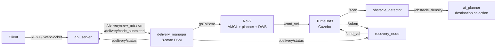
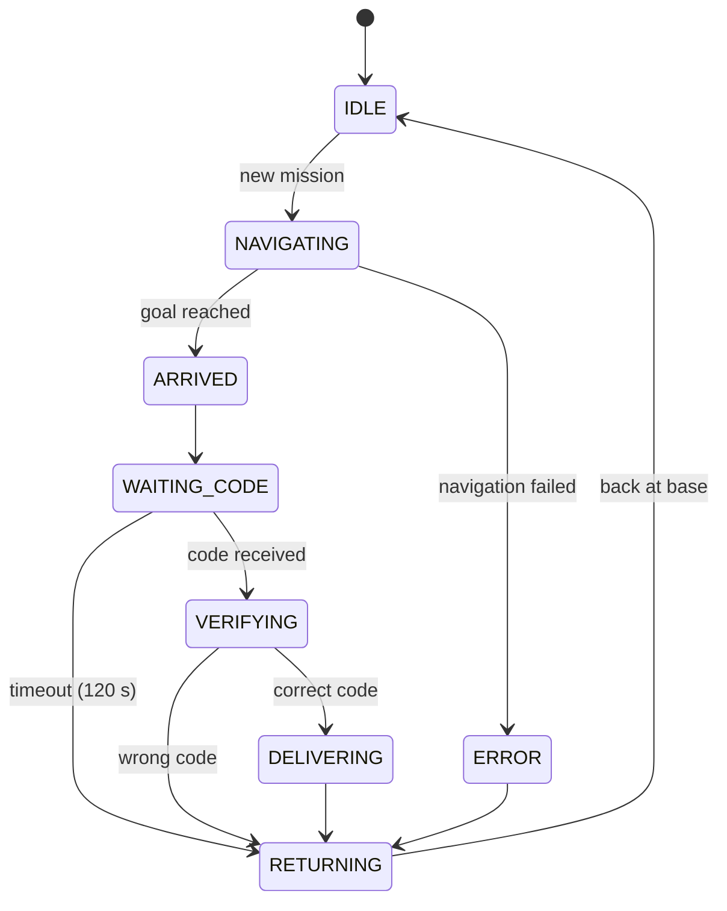

# PatrolBot: Autonomous Delivery Robot

[](https://docs.ros.org/en/humble/)
[](https://classic.gazebosim.org/)
[](LICENSE)

> **Context:** a 2025 master's project at Université Ibn Tofail (Master IA et Objets Connectés). I took it up again and adapted it in 2026 before publishing it here.

PatrolBot is an autonomous delivery robot built on **ROS 2 Humble** and **Nav2**, simulated in Gazebo with a TurtleBot3 Waffle Pi. Customers send a mission through a **REST API**. The robot drives to the address, waits for a **delivery code**, then returns to its base. If it gets stuck along the way, it **recovers on its own**.

> Mission flow in one request: `POST /api/mission` → Nav2 navigation → code check at the door → return to base. An 8-state FSM drives the whole flow and recovers from every failure.

---

## Features

| Module | What it does |
| --- | --- |
| Perception | Converts the 360° LiDAR scan into obstacle density over 36 sectors of 10° each |
| Destination selection | Ranks candidate destinations with a weighted multi-criteria score (distance, time, obstacles in that direction, risk, energy) |
| Delivery manager | Runs an 8-state FSM on top of Nav2: code timeout, constant-time code check, error recovery |
| Self-recovery | Detects a stuck robot from odometry during a mission, then backs up and spins in place |
| API | Exposes REST endpoints with input validation, plus a WebSocket for live tracking |
| World | Provides a custom urban Gazebo world (roads, houses, vehicles, pedestrians) |

## Architecture



### Delivery state machine



---

## Project structure

```text
patrolbot/
├── src/
│   ├── patrolbot_perception/   # LiDAR → obstacle density per sector
│   ├── patrolbot_ai/           # multi-criteria destination selection (scoring.py, no ROS dependency)
│   ├── patrolbot_delivery/     # delivery FSM on top of Nav2
│   ├── patrolbot_recovery/     # stuck detection (stuck_detector.py) and maneuvers
│   ├── patrolbot_api/          # FastAPI server (REST + WebSocket)
│   ├── patrolbot_world/        # custom Gazebo worlds
│   ├── patrolbot_bringup/      # full launch file
│   └── gazebo_map_creator/     # submodule: map export from a Gazebo world
└── start_patrolbot.sh          # one-command launch
```

## Installation

```bash
sudo apt install ros-humble-desktop ros-humble-turtlebot3 ros-humble-turtlebot3-simulations \
  ros-humble-navigation2 ros-humble-nav2-bringup ros-humble-slam-toolbox
pip install fastapi uvicorn

git clone --recurse-submodules https://github.com/youri-nkouakep/patrolbot.git
cd patrolbot
colcon build --symlink-install
source install/setup.bash
```

## Launch

First build a map of the world with SLAM Toolbox, then save it to `~/maps/patrolbot_map.yaml`.

```bash
./start_patrolbot.sh                     # or: ./start_patrolbot.sh path/to/map.yaml
```

To launch the custom urban world on its own:

```bash
ros2 launch patrolbot_world delivery_city.launch.py
```

## Send a delivery mission

```bash
curl -X POST http://localhost:5000/api/mission \
  -H "Content-Type: application/json" \
  -d '{"destination_x": 0.5, "destination_y": 0.3, "delivery_code": "1234"}'

curl -X POST http://localhost:5000/api/code \
  -H "Content-Type: application/json" -d '{"code": "1234"}'
```

| Method | Endpoint | Description |
| --- | --- | --- |
| GET | `/api/status` | Robot position and FSM state |
| POST | `/api/mission` | Send a mission (`409` if the robot is busy) |
| POST | `/api/code` | Submit the delivery code (`409` if no code is expected) |
| WS | `/ws/tracking` | Live position and state stream at 2 Hz |

Swagger UI: http://localhost:5000/docs

## Tests

The scoring, stuck-detection and mission-parsing logic is kept free of ROS dependencies and covered by unit tests:

```bash
colcon test --packages-select patrolbot_ai patrolbot_recovery patrolbot_delivery
colcon test-result --verbose
```

## Performance

Values measured in simulation:

| Metric | Measured | Requirement |
| --- | --- | --- |
| Perception latency | 0.8 ms | < 100 ms |
| API latency | 15 ms | < 500 ms |
| WebSocket rate | 2 Hz | > 1 Hz |
| Code verification | 8 ms | < 100 ms |

Recovery maneuvers are configured in `stuck_detector.py`: a 0.3 m backup (3.0 s), then a half turn in place (3.1 s).

## Current limitations

- The robot has only been tested in simulation so far.
- The recovery node publishes on `/cmd_vel` alongside the Nav2 controller. A cleaner design would move these maneuvers into Nav2's behavior tree.
- Destination selection uses straight-line distance and does not feed Nav2 missions yet.

## Roadmap

### 1. Engineering quality
- [x] Unit tests for the core logic (scoring, stuck detection, mission parsing)
- [ ] Score destinations with the **real Nav2 path length** (`ComputePathToPose`) instead of straight-line distance
- [ ] Rewrite the LiDAR perception node in **C++ (`rclcpp`)** and compare its latency with the Python version
- [ ] Integration tests with `launch_testing`, plus **GitHub Actions CI** (`colcon build` and tests on every push)
- [ ] **Dockerfile** to run the whole simulation with one command

### 2. Real robot
- [ ] Deploy on a **real TurtleBot3 at UTBM**: SLAM map of a corridor, then 10 deliveries
- [ ] Report the success rate and mean delivery time, with a demo video

### 3. Vision
- [ ] **Safety stop**: YOLO person detection on the robot camera; the robot slows down, then stops under a distance threshold. Metrics: detection recall, stopping distance
- [ ] **Precise docking** at the delivery point: ArUco or AprilTag markers, pose from PnP, camera-guided final approach. Metric: final position error in cm, compared with AMCL alone
- [ ] **LiDAR + camera fusion**: classify obstacles as people or objects and write them into a Nav2 costmap layer, to keep a wider margin around people

### 4. Showcase: a real delivery fleet
- [ ] **2 real TurtleBots** (or 1 real + 3 simulated), each in its own ROS 2 namespace with Nav2
- [ ] Mission assignment with the **Hungarian algorithm** (cost = Nav2 path length), with automatic reassignment when a robot is stuck
- [ ] **Web fleet dashboard** (React + WebSocket): live map, mission queue, video stream of each robot
- [ ] **Benchmark on 30 deliveries**: success rate, deliveries per hour, gain from 2 robots over 1
- [ ] 90-second demo video: both robots in a UTBM corridor

---

## Team and my role

Team of 3: **Youri Nkouakep** ([@youri-nkouakep](https://github.com/youri-nkouakep)), N'faly Sangare and Zakaria Nasr-Allah.

**I designed and implemented the software**:
- ROS 2 architecture and the 5 nodes (perception, destination selection, delivery FSM, recovery, API);
- Nav2 and SLAM integration, the Gazebo worlds and the performance measurements.

My teammates wrote the documentation (specifications and project report).

Master IA et Objets Connectés, Université Ibn Tofail (Kénitra). Module: Real-Time Systems, 2025.

## License

MIT, see [LICENSE](LICENSE).
